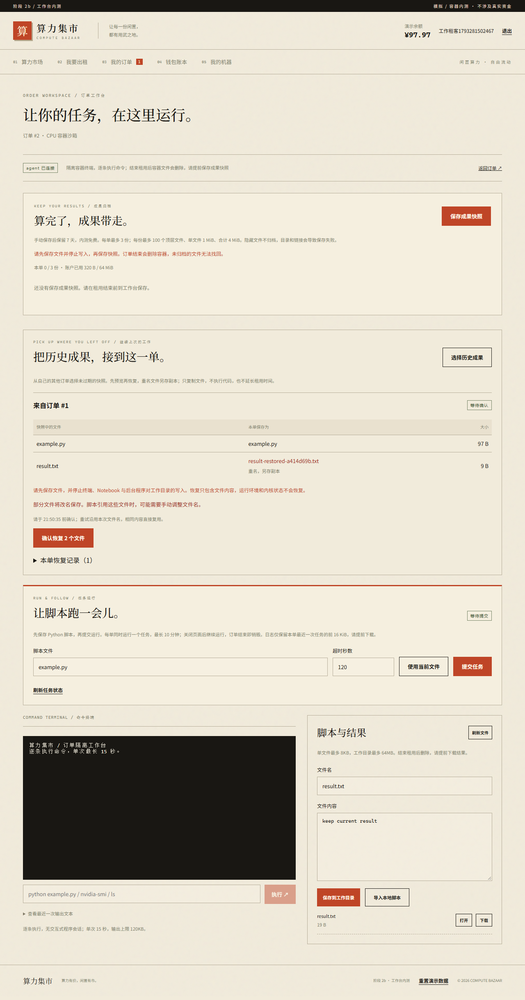
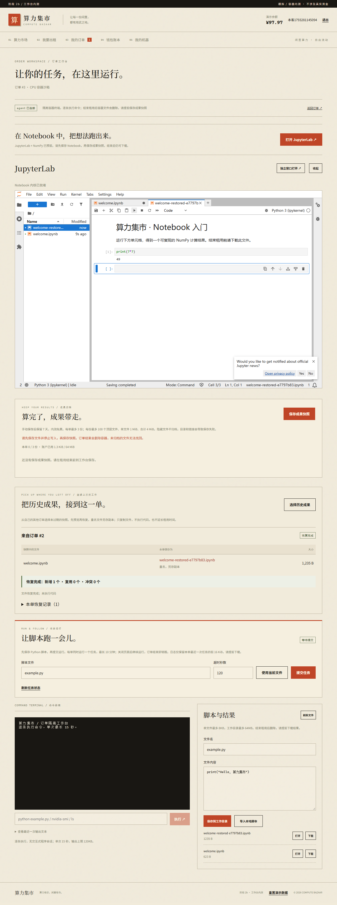

# 跨订单成果恢复：开发与验收记录

日期：2026-10-29。范围：本机受邀 Docker 工作台的文件延续，不涉及真实资金、自动断点训练或公网发布。

## 实现结果

- 新订单工作台选择自己的其他订单未过期快照，预览文件去向，确认后才复制文件。
- 重名生成固定副本名，兼顾中文及 Linux 文件名字节上限；目标被改动时报告冲突，不覆盖不同内容、目录、符号链接或 FIFO。
- 支持现有快照的文本、Notebook、空文件与二进制，沿用 100 文件、每个 1 MiB、合计 4 MiB 上限。顶层结构可以再次归档。
- 固定计划、逐文件回执和待核对状态保存在 v5 数据库。断线或服务重启后可查询；同计划重试复用逐字节相同的目标，成功重复确认不重发。
- 保留真实执行结果，即使写入期间退出登录；HTTP 响应仍重新鉴权。普通工作台入口不能自行构造恢复正文。
- 无新增依赖或镜像重建。agent 更新为 0.5.0，旧接入进程需要重启加载协议。完整使用方法见[恢复指南](../app/docs/restore-guide.md)。

## 验证

| 验证 | 结果 |
| --- | --- |
| TypeScript + Vite 生产构建 | 通过，50 modules |
| 全量单元、接口与真实容器回归 | 当时 74 项 / 11 文件全部通过，启用 Docker、Notebook、PyTorch 三个真实测试开关并串行执行 |
| 后补长中文文件名边界 | 增加 1 项后定向重跑恢复模块，12 项通过；当前共 75 项测试均有通过记录 |
| 全部 Playwright 流程 | 6 / 6 通过，约 2 分钟；启用 Docker、GPU、Notebook、PyTorch |
| 真实二进制恢复 | 4 个 1 MiB 文件，经 stdin 写入；再次归档逐字节一致，同计划再执行全部复用；空文件也通过 |
| 危险目标与坏数据 | 文件变化、大小写别名、链接、目录、FIFO、路径穿越、坏 Base64 与坏摘要均拒绝；预检失败不创建其他新文件 |
| API 边界 | 外部账号、机主、过期会话/计划/来源、源删除与变化、并行请求、退出登录、异常回执、旧 running 计划重试、开发重置外键均覆盖 |
| 移动端 | 390px 无整页横向溢出，预览表三列均在容器宽度内；已检查截图 |

主要执行命令（在 `app` 内，PowerShell 设置对应环境变量为 `1`）：

```text
npm test -- --no-file-parallelism
npx vitest run tests/restores.test.ts
npm run test:e2e
npm run build
```

真实 CPU 浏览器流程：原订单运行脚本得到 `answer=42` → 保存快照 → 结束并确认清理 → 新订单先创建不同内容的 `result.txt` → 预览显示另存副本 → 确认恢复两文件 → 原文件仍是 `keep current result`，副本为 `answer=42` → 刷新仍显示回执 → 用户主动执行恢复脚本得到 42 → 再归档三文件 → 结束后下载 ZIP，验证包含副本名。

真实 Notebook 浏览器流程：旧 `.ipynb` 保存 NumPy 输出 45 → 归档、结束清理 → 新 Notebook 订单恢复为 `welcome-restored-xxxxxxxx.ipynb` → 新默认 welcome 未被覆盖 → 从 JupyterLab 文件列表打开副本，旧输出 45 保留 → 在新内核修改代码计算 49 → 保存、再归档、结束、下载验证 49。证明文件和输出延续，并验证新内核可重新运行。

原有 mock 接入、交易与钱包、模拟工作台、GPU/PyTorch 计算及清理流程也均通过本轮浏览器回归。

## 数据保留

迁移前运行在线备份：`app/data/backups/market-1793263834301.sqlite`。升级自动生成 `app/data/market.sqlite.before-v5.bak`。

对升级前 v4 快照与当前主数据库逐行比较：users 6、machines 6、listings 6、orders 2、ledger 10、order_archives 0，六张表完全一致；`PRAGMA quick_check = ok`。本轮测试使用独立内存库或独立 E2E 数据库，没有重置用户主库。主库本来没有成果快照，不能恢复未保存的旧容器文件。

## 截图






[移动端截图](shots/mobile-restore.png)

## 当前边界与下一步

恢复是逐文件发布，发布中断可能部分完成；不通过删除用户文件伪装全局回滚。断线时记录待核对，计划有效期内可沿原映射重试。用户需先停止 Notebook、后台程序写入。没有自动归档、递归目录、任意 ZIP 上传或环境重建，单条命令仍限 15 秒。

下一步优先做独立的长时任务、日志与停止操作，并服从订单租约；独立机主断网、强杀与重连演练需要另一台可控机器。多卡隔离、陌生用户隔离和公网部署仍未完成验收。
