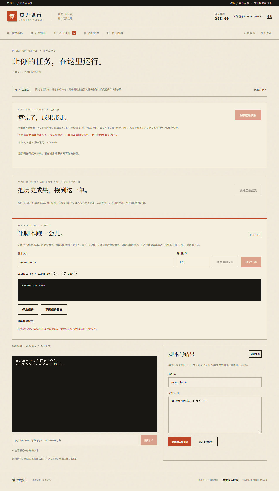

# 长时 Python 任务：开发与验收

日期：2026-10-29。本轮在现有工作台上加入独立脚本任务，不涉及真实支付或公网部署。

## 交付

运行入口、超时设置、状态、实时日志、日志下载和停止操作。每单一个活动任务、最多 20 次提交，脚本最多 8 KiB、最长 600 秒、默认 120 秒。日志仅保留最近一次任务的前 16 KiB。刷新或关闭页面后任务继续，订单结束随容器销毁。运行中禁止归档与恢复文件。详见[任务指南](../app/docs/task-guide.md)。

root 监督器保护 `/lease` 记录，实际代码 UID/GID 1000、有效 capabilities 为 0。为切换身份，在 cap-drop ALL 后仅增加 SETUID/SETGID；root Python 用 -I 防止用户同名模块被加载。保留无网络、只读根目录、无宿主挂载、no-new-privileges、原 CPU/内存/进程和租约限制。无需重建镜像，机主端加载 agent 0.6.0，新订单启用。

## 验证证据

- 全量单元、接口与真实 Docker/Notebook/PyTorch：79 / 79，12 文件通过，启用三个真实测试开关并串行执行。
- 后续定向复测：18 项工作台接口通过，覆盖在途状态查询时结束订单；任务停止测试再次通过，增加 UTF-8 BOM、future import、真实子进程有效 capabilities 为 0 的检查。
- 真实 CPU 任务 sleep 16 秒后生成 answer=42，超过原终端上限；可实时查询 UID 1000 日志，同请求重复提交不重启，重建执行器对象可查询同一任务。
- 真实容器验证手动停止、超时停止、日志截断、异常退出、路径/链接/FIFO 拒绝、任务中禁止归档、root 状态不可读及租约到期停止容器。工作目录放置恶意同名 subprocess.py 也不会被 root 监督器加载。
- 页面回归涵盖 6 条原有流程；CPU 场景增加提交任务、刷新后查询运行、归档禁用、停止、日志下载和 390px 布局检查，再完成脚本、归档、恢复与清理。其他 5 条覆盖 mock 机器、交易、Notebook、模拟终端和真实 GPU。
- 构建通过，TypeScript + Vite 共 51 modules；主程序健康检查 schema v5。

浏览器回归发现并修复了两个问题：轮询与终端/归档/恢复共用通道时相互抢占，现在统一排队；订单结束时在途日志查询返回 410，现在只向已登录的订单租客返回空任务，不继续转发容器，也不返回迟到日志。停止、启动及其他工作台操作仍拒绝已结束订单。

## 数据与环境

开发前在线备份 `app/data/backups/market-1793280240650.sqlite`。主库 users 6、orders 2、ledger 10、order_archives 0、order_restores 0，逐行与本轮备份比较一致，quick_check 为 ok。没有数据库迁移或主库重置，测试使用独立数据库。

Docker Desktop 启动受遗留 socket 文件影响；确认 Docker 进程已退出、两个明确目录只有零字节 reparse-point 文件后，将目录改名保留并重新启动。未删除镜像、卷、业务数据库或修改 WSL 内存配置。

[移动端截图](shots/mobile-long-task.png)

## 后续

本轮真实长任务以 CPU 脚本验收，原 GPU CUDA 示例回归通过；GPU 长任务压力、多卡与独立机主故障演练仍需单独开展。后续可增加持久化任务历史和长期日志。当前不提供调度队列、自动断点训练、任意依赖安装或跨订单进程恢复。刻意脱离进程组的程序仍以订单容器租约为最终边界。
